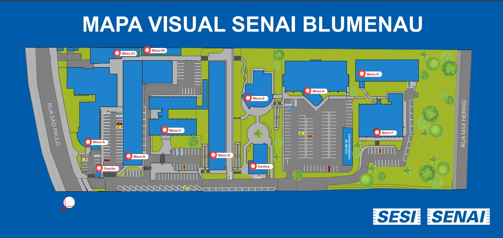

# Problema

Texto original do desafio:

> Atualmente, não há uma forma confiável de informar a disponibilidade de vagas de estacionamento no período noturno nos blocos A, C e H. Em diversas situações, os vigias orientam os motoristas de que não existem vagas disponíveis, fazendo com que estacionem em locais mais distantes. No entanto, posteriormente é constatado que ainda havia vagas livres nos estacionamentos desses blocos, gerando deslocamentos desnecessários, perda de tempo e insatisfação dos usuários.

## Mapa do campus

A guarita fica na entrada pela Rua São Paulo, no canto de baixo à esquerda.
